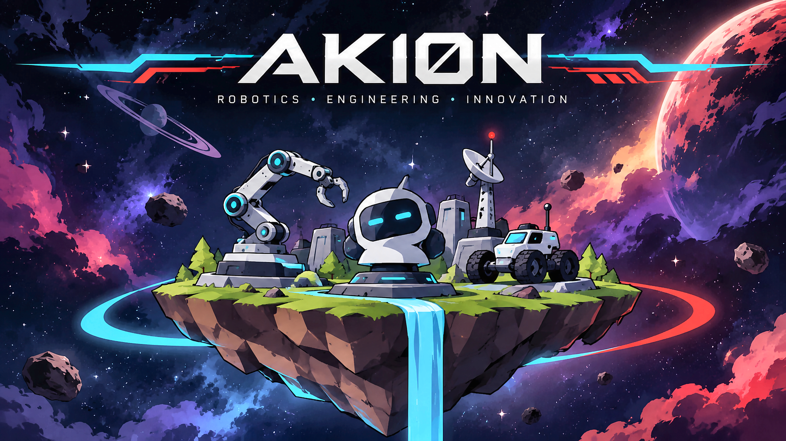

# ⚡ AKI0N Robotics

  

  <!-- Pin 1: Mini Sumo (Brazo robótico) -->
  <a href="robots/mini-sumo/" class="hotspot" style="top: 48%; left: 34%;" data-title="Mini Sumo">
    
    Mini Sumo
  </a>

  <!-- Pin 2: Sobre AKI0N (Robot central) -->
  <a href="#proyectos" class="hotspot" style="top: 52%; left: 49%;" data-title="Proyectos">
    
    Sobre AKI0N
  </a>

  <!-- Pin 3: Soccer Pro (Rover) -->
  <a href="robots/soccer-pro/" class="hotspot" style="top: 58%; left: 66%;" data-title="Soccer Pro">
    
    Soccer Pro
  </a>

  <!-- Pin 4: Comunidad y Redes (Antena) -->
  <a href="contacto.md" class="hotspot" style="top: 42%; left: 62%;" data-title="Comunidad">
    
    Contacto
  </a>

Plataforma oficial de documentación técnica, esquemáticos y guías de ensamble para robots de competencia y proyectos.

---

Diseñada para dos mundos: apasionados por la tecnología que buscan armar proyectos para aprender y experimentar desde casa, y competidores nuevos que buscan cómo dar sus primeros pasos en este entorno. Ya sea por curiosidad de construir o por las ganas de competir, aquí tienes el punto de partida ideal.

[Explorar Robots :octicons-arrow-right-24:](robots/soccer-pro/acerca-de.md){ .md-button .md-button--primary }
<!-- [Catálogo en Cults3D :material-cube-outline:](https://cults3d.com/es/usuarios/aki0n){ .md-button target="_blank" } -->

---

## 🚀 Proyectos y Categorías

-   ### ⚽ Soccer Pro

    ---

    Velocidad, precisión y reflejos en la cancha. Una categoría dinámica y entretenida donde el control del piloto define cada gol.

    [:octicons-arrow-right-24: Ver Guía de Ensamble](robots/soccer-pro/acerca-de.md)

-   ### 🥋 Mini Sumo

    ---

    Estrategias y empuje sobre el Dojo. La categoría clásica de combate donde el objetivo es uno solo: no caer del ring.

    [:octicons-arrow-right-24: Ver Documentación](robots/mini-sumo.md)

-   ### 🛒 Tienda Oficial STL

    ---

    Lleva tus proyectos de la pantalla a la realidad. Diseños listos para descargar, imprimir en 3D y poner a prueba en pista.

    [:octicons-arrow-right-24: Ir a Cults3D](https://cults3d.com/es/usuarios/aki0n){ target="_blank" }

---

---

## 🤝 Soporte y Comunidad

¿Armaste uno de nuestros diseños o tienes dudas con alguna conexión? Escríbeme por mensaje directo en Instagram [**@_akion_**](https://www.instagram.com/_ak10n_/) o visita nuestro apartado de [**Redes y Contacto**](contacto.md). ¡Comparte fotos de tu robot terminado para incluirlo en la galería!