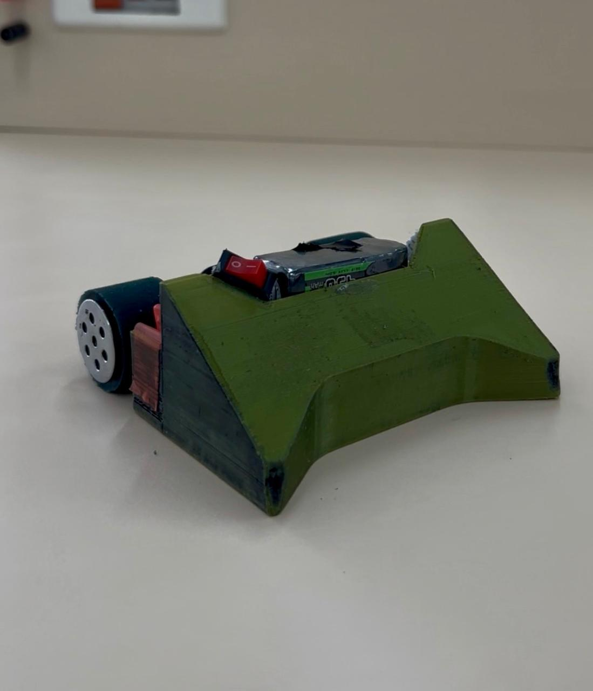

---
hide:
  - toc
---
# 🏆 Robots de Competencia

Explora la documentación técnica, reglamentos, esquemáticos y archivos 3D de nuestras plataformas diseñadas para torneos nacionales e internacionales.

  <!-- Tarjeta Soccer Pro -->
  

    

      

        ⚽ Soccer Pro (10×10 cm)
        PRO
      

      

        Robots de tracción rápida para partidos 2v2 / 3v3. 
      

    

    <!-- Fila inferior: Enlace a la izquierda + Miniatura a la derecha -->
    

      <a href="soccer-pro/acerca-de/" style="color: #00e5ff; font-weight: bold; text-decoration: none; font-size: 0.95rem; padding-bottom: 4px;">
        → Explorar Soccer Pro
      </a>
      
    

  

  <!-- Tarjeta Mini Sumo -->
  

    

      

        🥋 Mini Sumo (500 g)
        RC / AUTO
      

      

        Guías desde nivel Amateur hasta Pro.
      

    

    <!-- Fila inferior: Enlace a la izquierda + Miniatura a la derecha -->
    

      <a href="mini-sumo/" style="color: #ff4d4d; font-weight: bold; text-decoration: none; font-size: 0.95rem; padding-bottom: 4px;">
        → Explorar Mini Sumo
      </a>
      
    

  

