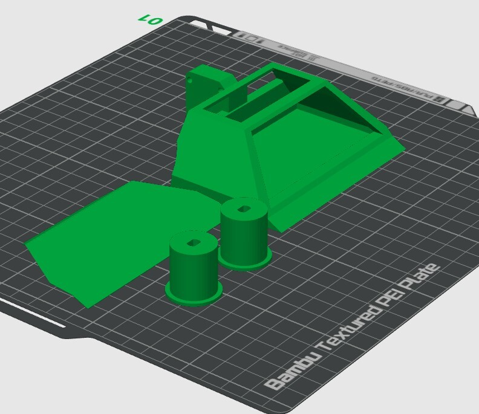

Si deseas adquirir los archivos STL listos para enviar a tu impresora 3D:

  <a href="https://cults3d.com/es/modelo-3d/variado/mini-sumo-rc-amateur-aki0n-2" target="_blank" style="background-color: #db4c4c; color: #ffffff; padding: 12px 30px; font-weight: bold; font-size: 1rem; border-radius: 8px; text-decoration: none; box-shadow: 0 4px 14px rgba(235, 118, 102, 0.35); display: inline-block; transition: 0.3s;">
    🛒 Descargar STL en Cults3D
  </a>

  
  
Orientación sugerida en la cama de impresión sin soportes en zonas críticas

## 📐 Dimensiones y Geometría del Diseño

El robot ha sido dimensionado estrictamente bajo el reglamento oficial de Mini Sumo (**máximo 100 × 100 mm de base**, sin límite de altura). Las cotas del chasis dejan la tolerancia exacta para incorporar el frente metálico y la cuchilla Kanzawa sin superar las medidas de homologación:

| Dimensión | Medida en CAD | Medida Final con Cuchilla | Margen Reglamentario (< 100 mm) |
| :--- | :---: | :---: | :---: |
| **Largo total (Eje X)** | **90.37 mm** (chasis base) | **~94.0 mm – 96.0 mm** (con cuchilla montada) | Margen seguro de 4 a 6 mm |
| **Ancho frontal (Eje Y)** | **98.00 mm** (filo de pala) | **98.00 mm** | Margen de 2 mm de tolerancia total |
| **Alto del chasis (Eje Z)** | **32.50 mm** (bahía interna) / **47.46 mm** (frente) | Variable según la altura de los motores TT | Sin límite reglamentario de altura |

---

### 🛞 Especificaciones Técnicas de Rines y Tracción

Los rines impresos en 3D están optimizados para los motores TT de 1 eje e integran pestañas de retención para evitar que los neumáticos se deslicen lateralmente bajo torsión:

* **Diámetro del cuerpo del rin:** Ø 20.0 mm (zona de asiento del neumático).
* **Ancho de tracción (extrusión del cuerpo):** 22.0 mm.
* **Pestaña limitadora de retención:** Ø 24.0 mm (borde exterior sobredimensionado).
* **Espesor de la pestaña limitadora:** 1.5 mm de extrusión lateral para asegurar la goma de silicona.
* **Neumáticos compatibles recomendados:** Gomas de silicona/caucho con radio interno de 18 mm y radio externo de 27 mm.
---

---

## ✂️ Especificaciones de Corte Metálico (`.dxf`)

Para el frente de choque:

* **Material recomendado:** Placa de acero inoxidable
* **Espesor sugerido:** 0.4 mm.

## ⚙️ Parámetros Recomendados de Impresión 3D

| Parámetro | Chasis Principal 
| :--- | :--- 
| **Material sugerido** | PLA+ / PETG / ABS 
| **Densidad de relleno** | 30% a 40%
| **Patrón de relleno** | Giroide o Rejilla 
| **Soportes** | Si es que es necesario