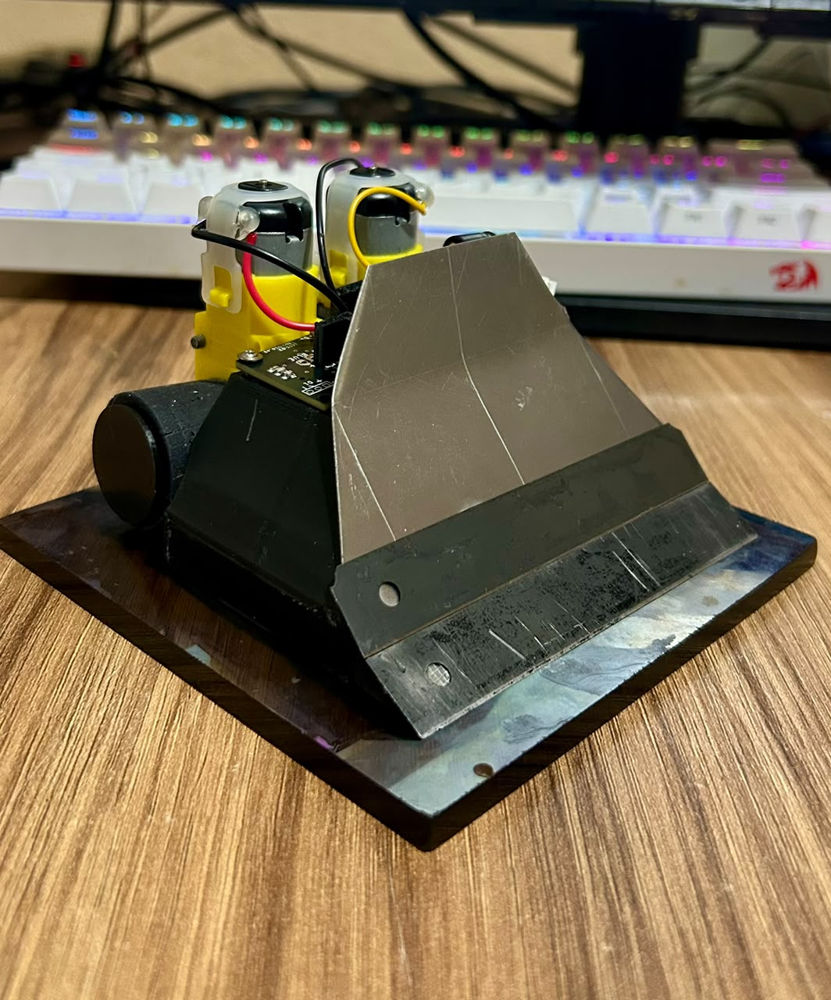
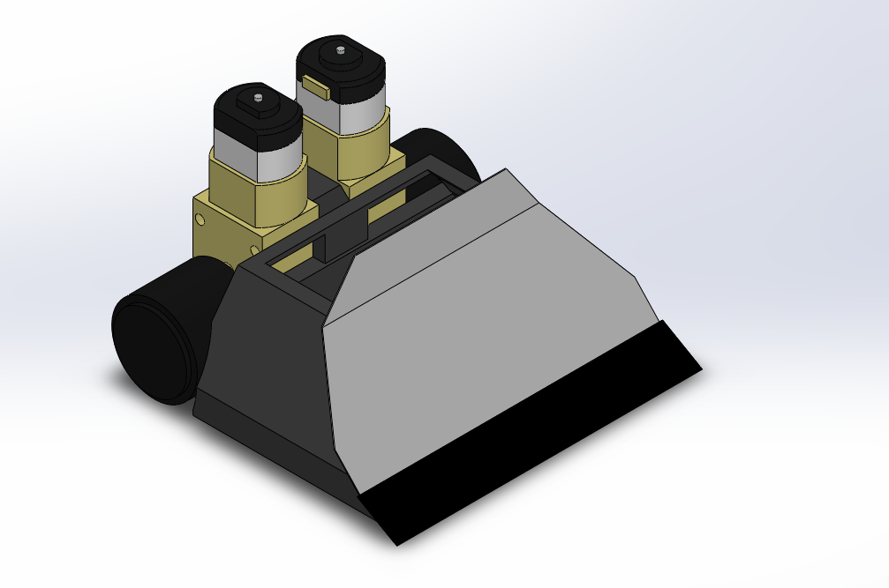
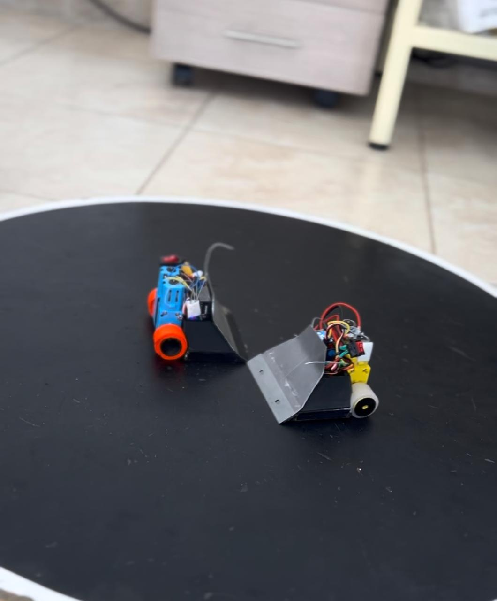

# 🎮 Mini Sumo RC Amateur

  <!-- Diapositiva 1 -->
  

    
  

  <!-- Diapositiva 2 -->
  

    
  

  <!-- Diapositiva 3 -->
  

    
  

  <!-- Botones de navegación -->
  <button class="carousel-btn carousel-prev" aria-label="Foto anterior">&#10094;</button>
  <button class="carousel-btn carousel-next" aria-label="Foto siguiente">&#10095;</button>

  <!-- Puntos inferiores -->
  

    
    
    
  

El **Mini Sumo RC Amateur** es el punto de partida perfecto para iniciarse en la robótica de combate. A diferencia de las categorías profesionales con componentes de alto costo, esta categoría está pensada para ser accesible, didáctica y competitiva utilizando elementos estándar como motorreductores plásticos tipo TT y radiocontrol/bluetooth tradicional.

Para construir tu robot paso a paso, sigue las secciones de esta documentación:

1. **[Materiales y Componentes](materiales.md):** Lista detallada de tornillería, componentes electrónicos, filamento recomendado y herramientas necesarias.
2. **[Ensamblaje y Conexiones](ensamblaje.md):** Guía paso a paso del montaje mecánico, cableado del puente H hacia el receptor y asignación de canales.
3. **[Descarga STL y Fabricación](descargas.md):** Archivos listos para mandar a la impresora 3D y parámetros recomendados de laminación.