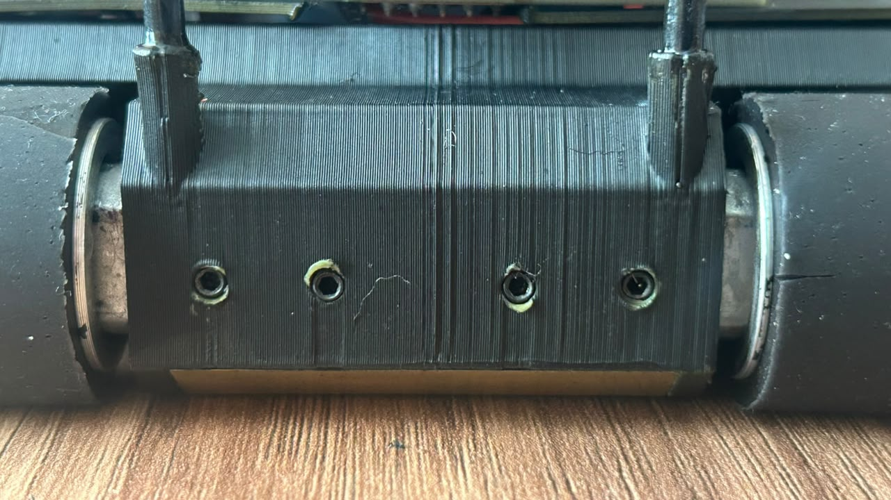
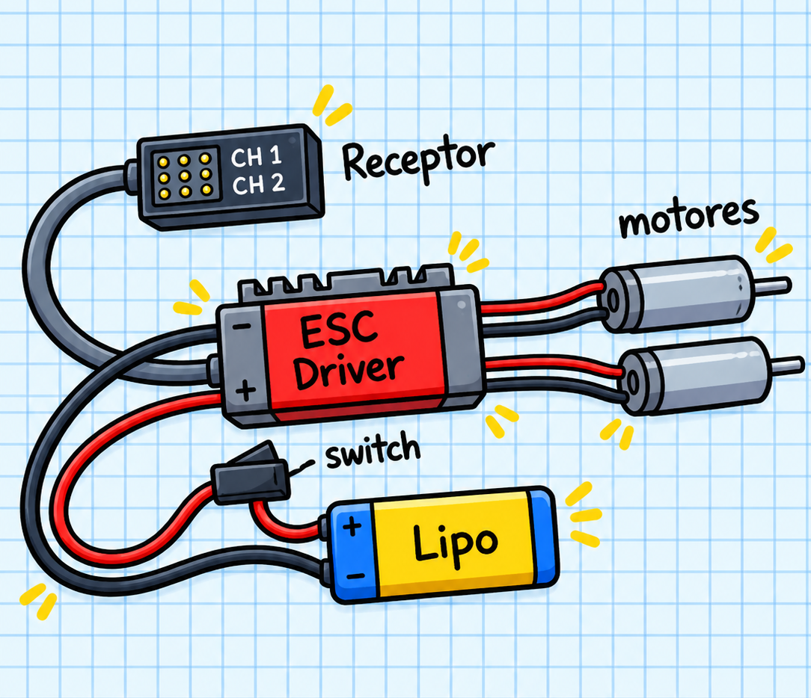

# 🛠️ Ensamblaje y Conexiones Eléctricas

El ensamblaje del **Mini Sumo RC Pro** combina un chasis modular bipartito impreso en 3D con un tren motriz de alto torque, fijación metálica de precisión y un sistema de control directo mediante ESC.

---

## 🔩 Paso 1: Montaje Mecánico de Tracción y Chasis

El diseño estructural se divide en **dos piezas principales** (base inferior y chasis superior) e incorpora alojamientos cilíndricos traseros para los motorreductores **FingerTech**:

1. **Fijación de Motores FingerTech:**
   - Desliza cada motorreductor FingerTech dentro de los cilindros traseros del chasis superior asegurando que los ejes queden alineados hacia el exterior y los terminales eléctricos orientados hacia el habitáculo interno.
   - En la parte posterior del alojamiento encontrarás **4 orificios roscados** (dos por motor). Inserta **prisioneros M2** y ajústalos firmemente contra la carcasa metálica de cada motor para evitar vibraciones o desplazamiento axial durante los impactos.
2. **Aros JSumo y Neumáticos:**
   - Introduce cada aro de aluminio **JSumo** en el eje de 3 mm del motorreductor haciendo coincidir el tornillo prisionero del rin con la cara plana (tipo D) del eje.
   - Aprieta el prisionero con llave Allen asegurando un ajuste mecánico sólido sin deslizamiento.
   - Monta las gomas de silicona/caucho (**Ø int. 15 mm / Ø ext. 26 mm**) sobre los aros verificando que asienten de forma uniforme y sin alabeos.

  

3. **Unión del Chasis Bipartito (Base y Cuerpo Superior):**
   - Una vez alojada la electrónica interna (ver Paso 2), cierra el habitáculo colocando la **base inferior**.
   - Fija ambas piezas utilizando **2 tornillos M3 avellanados** y **2 tornillos M2 avellanados** en los alojamientos cónicos inferiores. Las cabezas deben quedar completamente al ras de la superficie inferior para evitar enganches con el borde del dohyo.
4. **Postes Traseros Anti-Volteo:**
   - En los dos cilindros verticales situados en la parte trasera superior del chasis, enrosca **dos tornillos M3** a modo de antenas/topes mecánicos. Estos postes actúan como soporte **anti-volteo**, impidiendo que el robot quede invertido si un oponente logra levantarlo por el frente.

!!! note "Nota sobre la pieza 'Base PCB'"
    En el paquete de archivos 3D se incluye una pieza denominada **Base PCB**, diseñada exclusivamente para quienes optan por montar una placa electrónica dedicada con microcontrolador y driver integrado. **Si estás armando esta configuración con controlador ESC convencional, omite esta pieza**, ya que el ESC y el receptor se alojan directamente en el compartimento central.

---

## ⚡ Paso 2: Cableado y Circuito de Potencia

Para alimentar el sistema de forma segura y soportar las corrientes pico de los motores FingerTech a **3S (11.1 V)**, se utiliza un conector de potencia compacto (XT30 o JST de alta corriente) centralizado hacia el controlador de velocidad (**ESC**):

  

!!! tip "Comprobación de giro de motores"
    Antes de cerrar la tapa inferior del chasis, realiza una prueba de tracción con el robot elevado. Si al accionar la emisora una rueda gira en sentido opuesto al deseado, intercambia entre sí los dos cables de alimentación de ese motor en el ESC para invertir el sentido de giro.

**Alojamiento Interno:**
- Instala el switch de corte general en su ranura dedicada del chasis para facilitar el encendido rápido en zona de combate.
- Acomoda el ESC, el receptor RC (2.4 GHz) y la batería LiPo 3S dentro del compartimento central, inmovilizándolos con cinta doble faz o espuma de alta densidad para que no se desplacen tras un choque frontal.

---

## 🛡️ Paso 3: Frente Metálico y Cuchilla Kanzawa

El sistema de choque y ataque frontal se compone de una cuña rígida inclinada y la cuchilla afilada de combate:

1. **Preparación y Corte del Frente Estructural:**
   - **Archivo DXF (Recomendado):** En la sección de descargas se incluye el archivo en formato `.dxf` para enviar a corte láser, CNC o realizar el corte manual sobre una lámina metálica de aluminio o acero.
   - **Archivo STL (Prototipado / Molde):** También se incluye el modelo en formato `.stl` para imprimirlo en 3D como plantilla de prueba, verificar tolerancias en el chasis o utilizarlo como guía de doblado antes de cortar la chapa definitiva.

2. **Fijación del Frente Estructural al Chasis:**
   - Coloca la cuña metálica sobre la cara inclinada frontal del chasis superior.
   - Asegúrala firmemente empleando **cinta doble faz de alta adherencia** (tipo 3M VHB / automotriz) o adhesivo estructural, presionando de forma uniforme durante 15 a 30 segundos para garantizar una unión sólida.

3. **Montaje de la Cuchilla Kanzawa:**
   - Aplica una tira de cinta doble contacto delgada sobre el labio inferior del frente metálico.
   - Adhiere la cuchilla de acero templado **Kanzawa** con el filo orientado hacia adelante y paralelo al plano del suelo, cuidando que roce suavemente el dohyo sin levantar el tren delantero.

!!! success "Verificación de asentamiento a contraluz"
    Coloca el robot completamente armado sobre una superficie de **vidrio totalmente plana** y observa el borde frontal a contraluz: **no debe filtrarse ninguna línea de luz** entre el filo de la cuchilla y el vidrio. Si entra luz por algún extremo, ajusta la presión o el ángulo de asiento hasta lograr un contacto continuo en todo el ancho sin que las ruedas pierdan tracción.

---

## ⚖️ Recomendación: Ajuste de Peso y Lastre

El límite máximo reglamentario de la categoría es de **500 gramos**. Acercarse lo máximo posible a este tope maximiza la fuerza normal sobre las gomas de silicona y la capacidad de empuje en el dohyo:

- **Material de la Pieza Base (Bronce Dulce vs. PLA):** Se recomienda mecanizar la **pieza base inferior en bronce dulce**. Gracias a su alta densidad, aporta una masa considerable justo en el punto más bajo del robot, bajando el centro de gravedad y acercando el conjunto al límite reglamentario sin necesidad de añadir lastre extra. Como alternativa accesible, puedes imprimir esta base en **PLA / PLA+**; sin embargo, al ser mucho más liviana, deberás compensar la diferencia de peso con contrapesos internos:
- **Plomos de balanceo adhesivos:** Si optas por la base impresa en 3D, utiliza contrapesos metálicos de balanceo de ruedas (plomos de taller). **Envuélvelos previamente con cinta aislante** para evitar cortocircuitos con los pines del receptor o el ESC, y fíjalos con cinta doble faz en los espacios libres del habitáculo.
- **Plastilina densa:** Para calibrar los últimos gramos en la báscula oficial de homologación, rellena cavidades internas libres hasta situar el peso total entre **485 g y 498 g**.
- **Distribución de masa:** Concentra el lastre adicional lo más bajo y adelantado posible (detrás de la cuña frontal) para evitar que el robot se encabrite al acelerar y mantener la cuchilla pegada al dohyo.