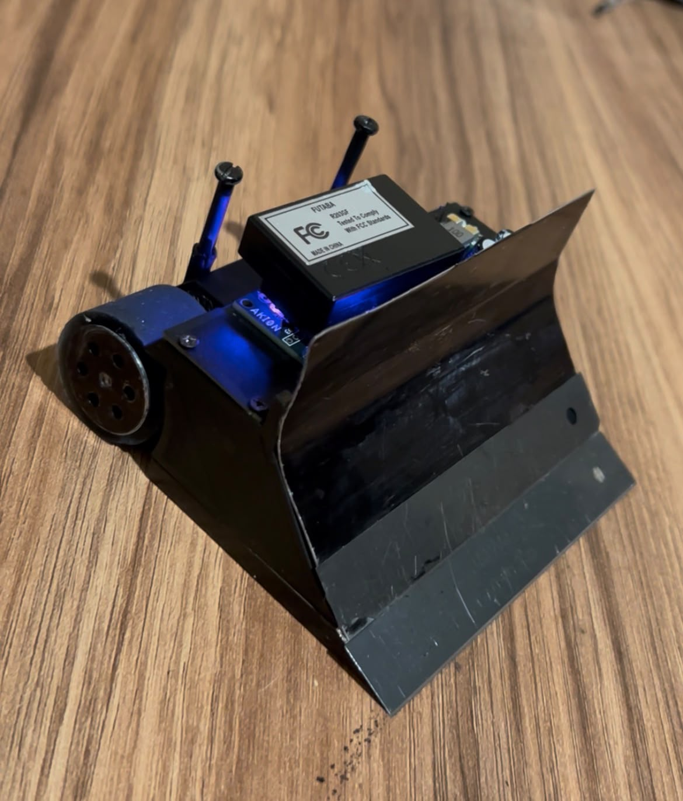
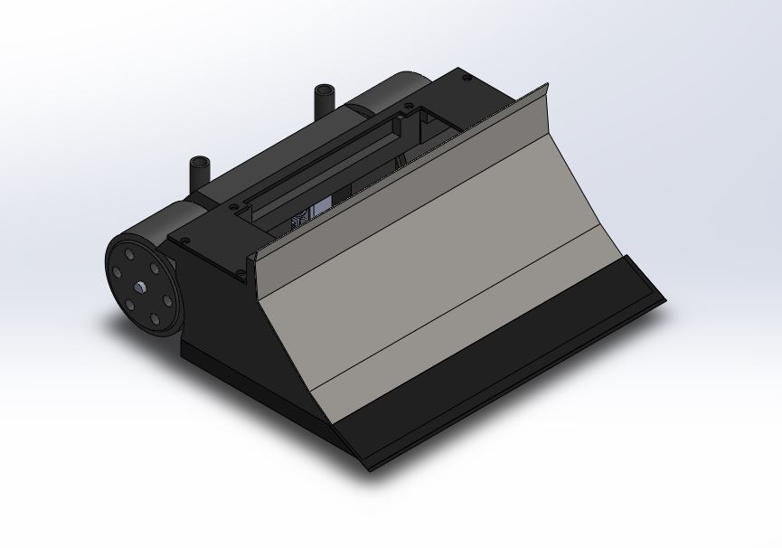
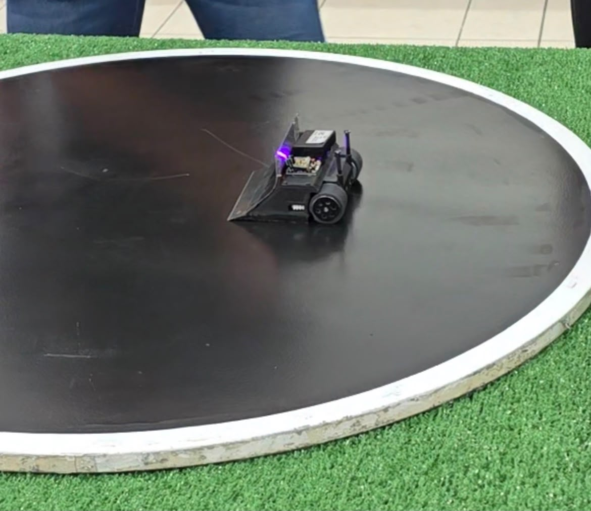

# 🎮 Mini Sumo RC Profesional

  <!-- Diapositiva 1 -->
  

    
  

  <!-- Diapositiva 2 -->
  

    
  

  <!-- Diapositiva 3 -->
  

    
  

  <!-- Botones de navegación -->
  <button class="carousel-btn carousel-prev" aria-label="Foto anterior">&#10094;</button>
  <button class="carousel-btn carousel-next" aria-label="Foto siguiente">&#10095;</button>

  <!-- Puntos inferiores -->
  

    
    
    
  

El **Mini Sumo RC Profesional** representa el máximo nivel de potencia, velocidad y precisión en la robótica de combate radiocontrolada. A diferencia de la categoría amateur, se utilizan motores metálicos de alto torque o velocidad y electrónica dedicada para lograr reacciones instantáneas en el dojo.

Para construir tu robot paso a paso, sigue las secciones de esta documentación:

1. [**Materiales y Componentes**](./materiales.md): Lista detallada de tornillería, componentes electrónicos, filamento recomendado y herramientas necesarias.
2. [**Ensamblaje y Conexiones**](./ensamblaje.md): Guía paso a paso del montaje mecánico, cableado del puente H hacia el receptor y asignación de canales.
3. [**Descarga STL**](./descargas.md): Archivos listos para mandar a la impresora 3D y parámetros recomendados de laminación.