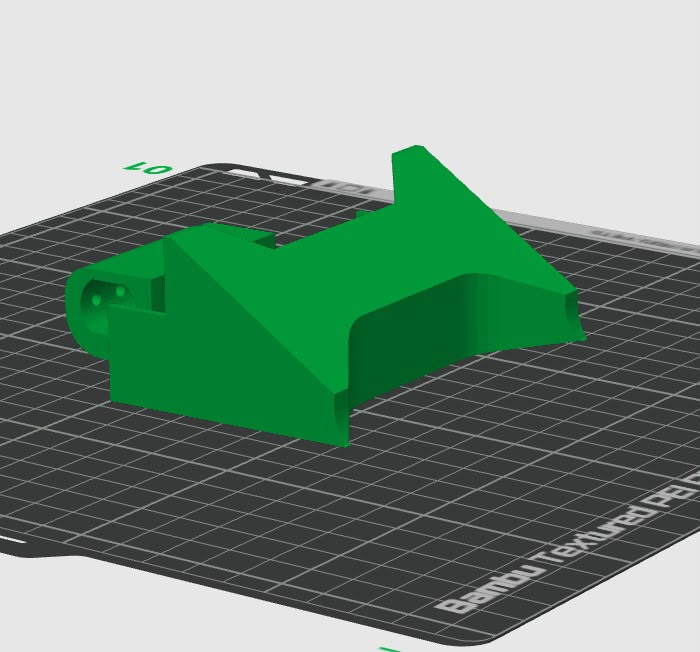

Si deseas adquirir los archivos STL listos para mandar a tu impresora 3D:

  <a href="https://cults3d.com/es/modelo-3d/variado/robot-soccer-professional" target="_blank" style="background-color: #db4c4c; color: #ffffff; padding: 12px 30px; font-weight: bold; font-size: 1rem; border-radius: 8px; text-decoration: none; box-shadow: 0 4px 14px rgba(235, 118, 102, 0.35); display: inline-block; transition: 0.3s;">
    🛒 Descargar STL en Cults3D
  </a>

  
  
Orientación sugerida en la cama de impresión sin soportes en zonas críticas

## ⚙️ Parámetros Recomendados de Impresión

* **Material sugerido:** PLA+ 
* **Altura de capa:** 0.20 mm
* **Relleno:** 40% a 50% (patrón Giroide o Rejilla)

