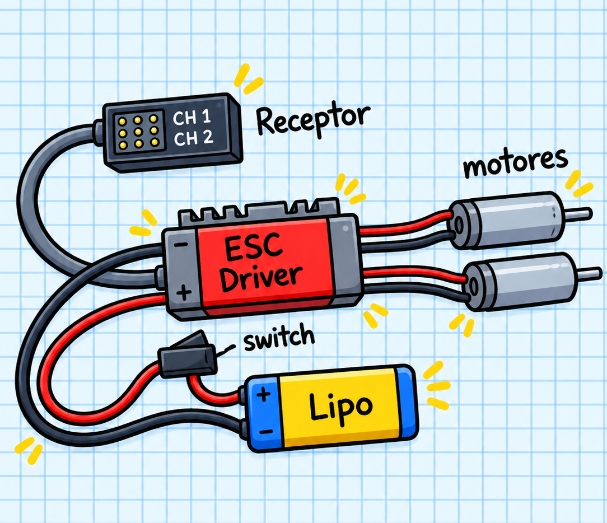

En esta sección se detalla el proceso de integración mecánica de los motores y el diagrama de conexión electrónica para el funcionamiento del robot.

### 1. Ensamblaje Mecánico

*  **Montaje de Motores:** Desliza los motorreductores dentro de sus soportes correspondientes en el chasis 3D.
*  **Fijación:** 
    En la parte posterior del chasis se incluyen perforaciones específicas para instalar **tornillos prisioneros**, lo que permite asegurar los motores a presión de forma firme y desmontable.
   * Alternativamente, si no dispones de prisioneros, puedes fijarlos aplicando una pequeña cantidad de **cianoacrilato** (pegamento instantáneo) en el área de contacto para evitar cualquier desplazamiento por vibración o impacto en pista.

---

### 2. Conexiones Electrónicas

Sigue este esquema para cablear la alimentación, el receptor y las salidas de potencia hacia los motores:
El cableado principal se centraliza a través del controlador de velocidad (ESC):

  

 Conecta los conectores de señal (cable tipo servo) del ESC a los canales correspondientes del receptor inalámbrico (habitualmente CH1 y CH2 para dirección y aceleración).